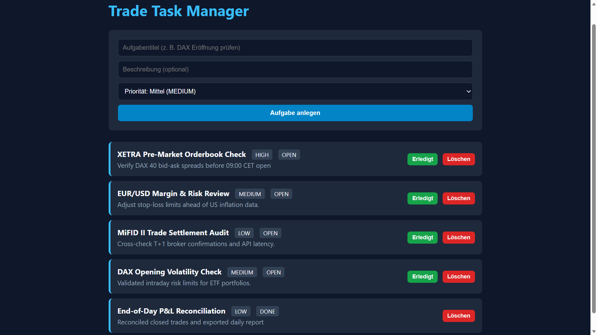
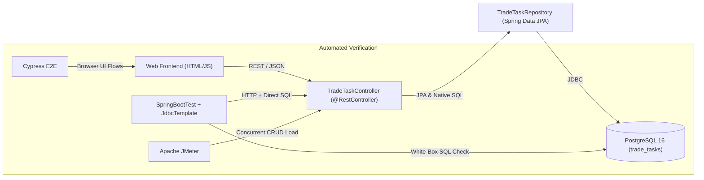
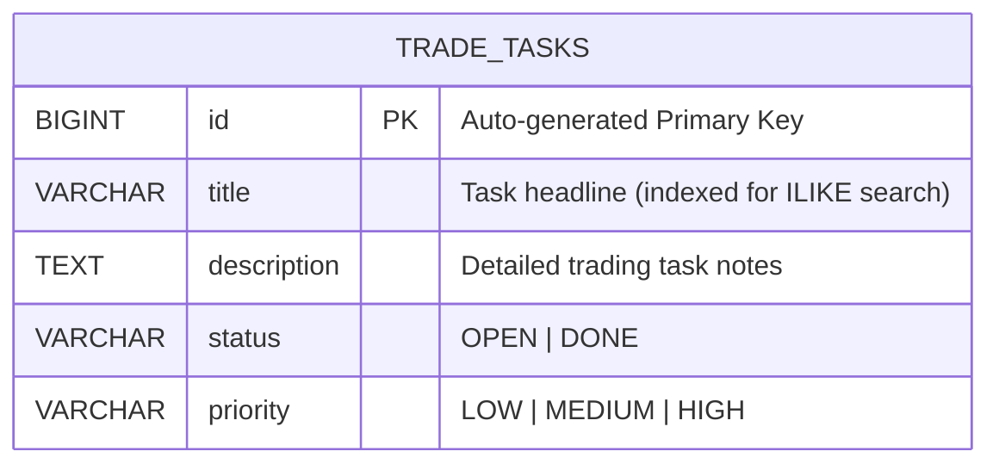
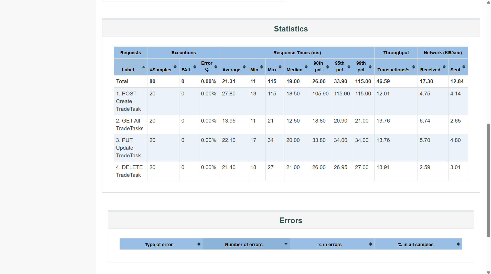
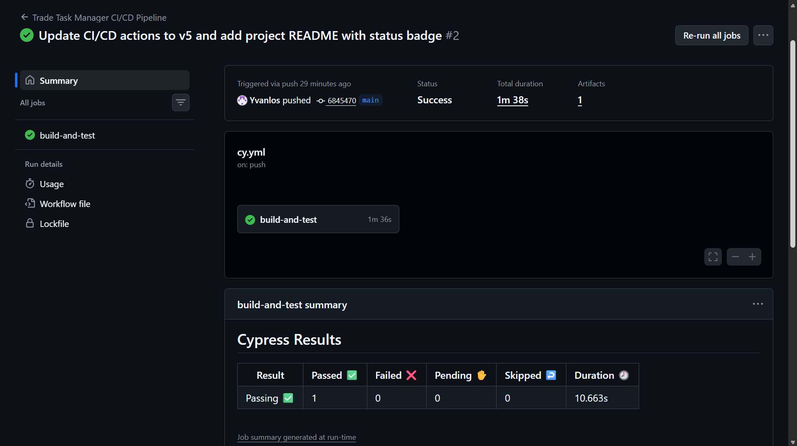
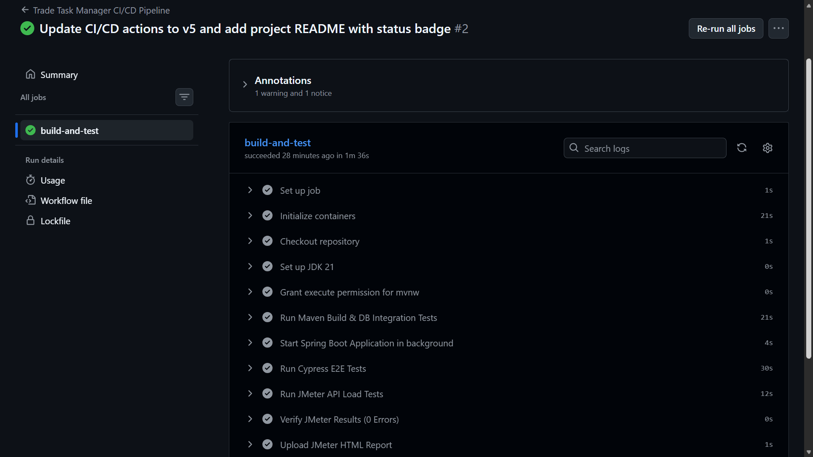

# Trade Task Manager


Full-Stack Trade Task Management application built with **Java 21**, **Spring Boot**, and **PostgreSQL**, engineered with a multi-layered **Automated Testing Strategy** (**API & Native SQL White-Box Integration Tests**, **Cypress E2E UI Tests**, **Apache JMeter Performance Tests**) and a **GitHub Actions CI/CD** pipeline.

---

## Application Preview



---

## System & Database Architecture

### 1. MVC & Layered Architecture
The backend follows a clean layered architecture separating HTTP routing, data persistence, and database execution:



### 2. Database Schema (`PostgreSQL`)
All trade tasks are persisted in the `trade_tasks` table using persistent Docker volumes:



---

## REST API Endpoints

| Method | Endpoint | Description | SQL / Persistence Mechanism |
| :--- | :--- | :--- | :--- |
| `GET` | `/api/tasks` | Retrieve all trade tasks | Spring Data JPA `findAll()` |
| `GET` | `/api/tasks/search?keyword=...` | Case-insensitive title search | Native PostgreSQL `ILIKE %:keyword%` |
| `GET` | `/api/tasks/stats` | Aggregated task counts by status | Native PostgreSQL `GROUP BY status` |
| `POST` | `/api/tasks` | Create a new trade task | JPA `save()` -> `INSERT` |
| `PUT` | `/api/tasks/{id}` | Update an existing trade task | JPA `findById()` + `save()` -> `UPDATE` |
| `DELETE` | `/api/tasks/{id}` | Delete a trade task by ID | JPA `deleteById()` -> `DELETE` |

---

## Test Strategy & Coverage

This project implements a **full-stack Test Pyramid** to verify functional correctness, database integrity, UI resilience, and system performance under load:

### 1. Test Pyramid & Strategy
- **API & Database Integration Layer (`JUnit 5` + `TestRestTemplate` + `JdbcTemplate`):**
  Instead of relying solely on HTTP `200 OK` status codes, tests perform **white-box database assertions** using raw SQL via `JdbcTemplate` directly against PostgreSQL. This eliminates false positives caused by ORM caching or mapping bugs.
- **End-to-End UI Layer (`Cypress`):**
  Covers both **positive user journeys** (creating, completing, and deleting tasks) and **negative edge cases** (validation of empty required fields, graceful UI error handling on `404`/`500` API responses via `cy.intercept()`).
- **Performance & Load Layer (`Apache JMeter`):**
  Simulates concurrent users executing full CRUD lifecycles (`POST` -> dynamic `$.id` extraction -> `GET` -> `PUT` -> `DELETE`) with strict `0%` error-rate assertions.

### 2. Test Coverage Matrix

| Feature / Endpoint | API + SQL Integration Test | Cypress E2E (Positive) | Cypress E2E (Negative) | JMeter Load Test |
| :--- | :---: | :---: | :---: | :---: |
| `POST /api/tasks` (Create) | ✅ (`INSERT` + `SELECT` check) | ✅ (Form submission) | ✅ (Empty title validation) | ✅ (10 threads × 2 loops) |
| `GET /api/tasks` (Read All) | ✅ | ✅ (List rendering) | ✅ (`500` server error stub) | ✅ (Payload assertion) |
| `GET /api/tasks/search` (`ILIKE`) | ✅ | — | — | — |
| `GET /api/tasks/stats` (`GROUP BY`) | ✅ | — | — | — |
| `PUT /api/tasks/{id}` (Update) | ✅ (`UPDATE` + `SELECT` check) | ✅ (Mark task `DONE`) | — | ✅ (Status assertion) |
| `DELETE /api/tasks/{id}` (Delete) | ✅ (`DELETE` + `COUNT(*)=0`) | ✅ (Remove from UI) | ✅ (`404` non-existent ID) | ✅ (`204 No Content`) |

---

## Performance & CI/CD Evidence

### Apache JMeter HTML Performance Report
Executed in headless CLI mode via Docker (`80` concurrent CRUD requests, `0.00%` error rate, `~21 ms` average response time):



### GitHub Actions CI/CD Pipeline
View all live pipeline runs and downloadable JMeter HTML report artifacts directly in the [**GitHub Actions Tab**](https://github.com).





Every `push` or `pull_request` automatically runs `.github/workflows/ci.yml`:
1. Starts a `postgres:16-alpine` service container with health checks.
2. Builds the Java 21 project and executes JUnit + PostgreSQL white-box SQL tests.
3. Launches the Spring Boot application and verifies health readiness on port `8080`.
4. Executes Cypress E2E tests (positive & negative cases) and Apache JMeter load tests (`0` errors enforced).
5. Uploads the generated **JMeter HTML Report** as a workflow artifact.

---

## Getting Started (Local Setup)

### Prerequisites
- Java 21 (JDK)
- Docker & Docker Compose

### 1. Start PostgreSQL Database
```bash
docker compose up -d
```

### 2. Run the Application
```bash
./mvnw spring-boot:run
```
Open `http://localhost:8080` in your browser.

### 3. Run Automated Test Suites
```bash
# 1. API & PostgreSQL SQL Integration Tests
./mvnw test

# 2. Apache JMeter Load Tests (requires running app on port 8080)
docker compose run --rm jmeter

# 3. Cypress E2E UI Tests
npx cypress run
```
